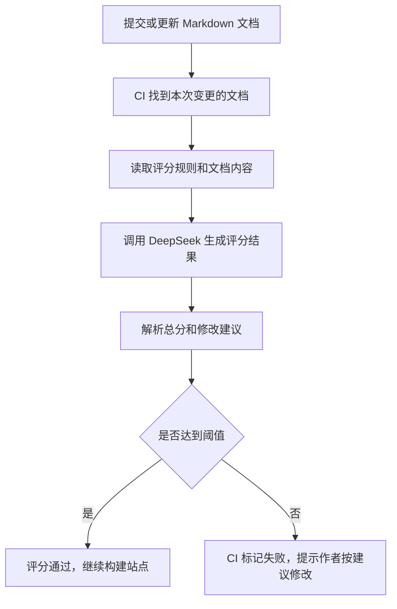
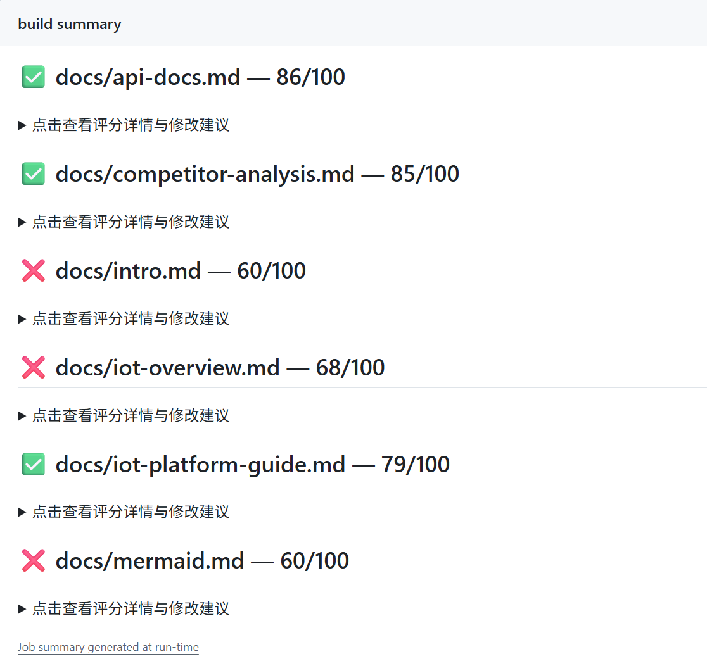

这篇记录我设计文档质量评估助手的过程，包括评分标准、修改建议的输出方式，以及如何接入 CI（持续集成）流程，让每次文档更新都自动接受检查。

{/* truncate */}

## 为什么要做这个助手

文档数量变多以后，我发现人工检查很难一直保持同样的标准。同一句话，今天觉得能看懂，隔几天再看又觉得缺少解释。一篇文档里出现过的问题，也可能在下一篇里重复出现。

修改时还要分清轻重。缺少一个操作步骤，可能会让读者无法完成任务；标点或措辞不合适，通常只是影响阅读。如果把这些问题混在一起，就不容易决定先改什么。

现有的 Markdown 格式检查能查空行、标题和列表，却无法判断内容是否讲清楚。因此，我想增加一个质量评估助手，让它按统一标准阅读文档，指出问题所在和影响，再给出具体修改建议。

## 助手的检查范围

我给助手设定的角色是开发者平台文档质量评估助手。它先判断文档主要用于操作、解释概念、查阅 API，还是介绍整体流程，再选择对应的评分标准。

每个扣分点都需要说明依据，例如引用原文，或指出没有找到的必要内容。建议按 P0、P1、P2 标出优先级，方便作者安排修改。结果还需要能写入 GitHub Actions 的日志和结果摘要，便于提交后查看。

它的职责限于评估文档质量。业务方案是否合理、文章是否要重写，仍由作者判断。

## 评分规则的设计

我先把检查项和扣分依据写进评分规则，再交给 AI 执行。规则分成两部分：所有文档都检查的通用维度，以及针对不同文档类型的专属维度。

### 通用维度

所有文档都要看这几项：

| 维度 | 分值 | 主要看什么 |
| --- | ---: | --- |
| 内容准确性与可信度 | 25 | 术语、路径、链接、参数、示例是否可靠 |
| 清晰可理解与一致性 | 15 | 结构是否清楚，前后说法是否一致 |
| 写作规范与文字质量 | 10 | 标题、标点、列表、表格、代码块是否规范 |
| 核心目标达成度 | 10 | 读者看完后能不能完成这篇文档本来要帮助完成的事 |

### 文档类型维度

不同类型的文档，再补两项专属维度：

| 文档类型 | 重点检查 |
| --- | --- |
| 操作指南型 | 步骤是否完整、是否可执行、有没有预期结果和排障 |
| 概念解释型 | 概念是否讲清楚、是否能帮助读者判断下一步 |
| API 参考型 | 接口信息是否完整、示例是否能照着用 |
| 流程总览型 | 是否能帮助读者看清全貌、快速选择路径 |

例如，操作指南需要检查步骤是否完整、失败后如何处理；概念文档则要检查定义和概念之间的关系。两类文档的目标不同，扣分依据也需要随之调整。

## 评分结果的内容

只有一个总分，作者仍然不知道从哪里改起。我要求助手先说明按哪种文档类型评分，再给出总分、各维度的得分和扣分依据。

检查内容覆盖情况时，要区分“提到了但没有讲完整”和“完全没有提供”。对于无法仅凭文档确认的内容，则单独列为人工复核项。

我最常看的是“核心问题与修改建议”。例如，一篇文档得了 68 分，建议中指出缺少下一步指引、没有帮助读者选择方案，或第一人称使用过多，作者就能分别检查对应段落，而不必猜测扣分原因。

## 评估流程

助手由评分提示词和调用脚本组成。脚本读取规则和文档，调用 DeepSeek，再解析分数与修改建议。下面是具体流程。

## 在 GitHub Actions 中查看结果

接入 CI 后，每次提交文档，脚本会找出本次修改的 Markdown 文件，逐篇调用助手。分数达到阈值后，继续构建和部署；低于阈值时，CI 标记失败，作者修改后再提交。

GitHub Actions 的结果摘要（build summary）会展示每篇文档的分数。通过的文档显示绿色勾，未通过的显示红叉，展开后可以查看评分明细和修改建议。

截图中的 `docs/intro.md`、`docs/iot-overview.md` 和 `docs/mermaid.md` 当时没有通过。后来，我给导览页补了阅读路径，给概念页补了不同角色的阅读建议。Mermaid 演示页对作品集的帮助不大，就删掉了。

## 根据评分结果修改文档

拿到评分后，我会按问题对读者的影响安排修改顺序。

| 优先级 | 怎么处理 | 示例 |
| --- | --- | --- |
| P0 | 直接影响文档是否能完成目标，优先改 | 缺少下一步、缺少阅读路径、缺少异常处理 |
| P1 | 影响可用性和理解效率，第二批改 | 配置项缺少解释、缺少操作成功后的验证方法 |
| P2 | 影响表达和规范，最后统一改 | 标题太大、链接文本不清楚、中英文空格 |

## 这次发现的问题

助手指出，原来的导览页只列了链接，读者仍然不知道从哪篇开始；IoT 概念页偏重个人理解，没有说明概念与平台接入的关系；接入指南虽然列出了步骤，却缺少异常处理和结果验证。这些建议让我能分别补充阅读路径、概念与操作的联系，以及关键步骤后的排查方法。

它也指出了一些表达和内容取舍问题，例如标题太像论文，以及 Mermaid 演示页对作品集的作用有限。这类问题不妨碍操作，但会影响读者理解站点内容。

自己重读也能发现其中一些问题，不过助手能把它们集中列出，并提示修改顺序。接入 CI 后，我可以在发布前查看这些建议，再决定怎么改。
