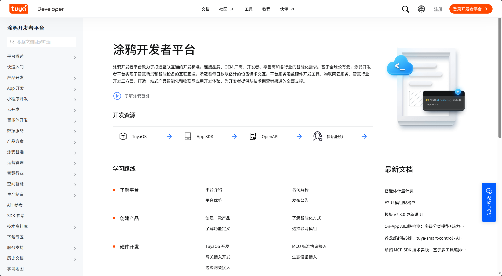
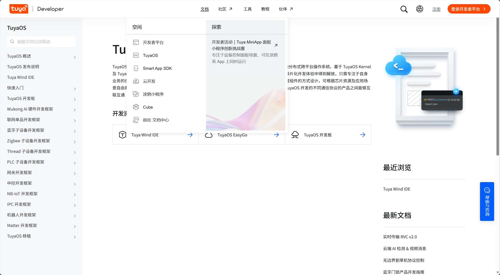
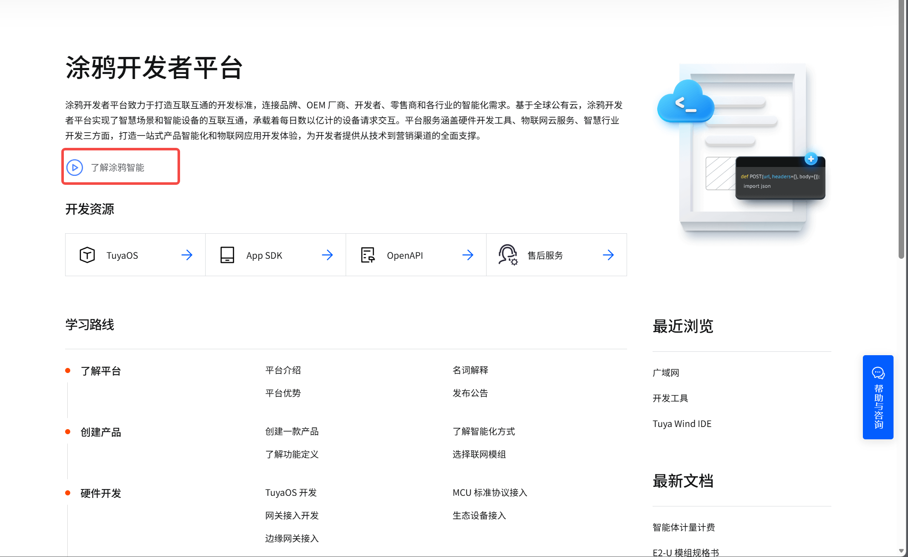

---
slug: iot-doc-thoughts
title: 一次 IoT 文档调研后的工作思考
authors: [yjh]
tags: [docs-as-code, doc-quality]
---

## 这次为什么看这些文档

开发者接入 IoT 平台时，需要先了解平台能力，再创建产品、接入设备，之后完成调试、上线和运营。文档需要说明这些步骤的顺序，以及每一步要查哪些资料、使用哪些工具。

这次主要看了涂鸦智能和 Apple HomeKit，关注它们怎么组织信息、怎么引导开发者、怎么管理术语、怎么提供对应的工具入口。

我希望从这两个平台的文档中，找到可以用于日常文档工作的做法。

{/* truncate */}

> 本文根据调研时看到的公开页面整理。页面和链接可能随版本调整，实际使用前需要核对最新文档。

阅读时，我先看新用户能否找到起点，再看导航能否带着读者完成任务。具体会检查内容是否准确完整、示例能否帮助操作，以及搜索、版本切换、代码展示和错误处理说明是否方便使用。

另外，我也留意同类页面的结构、术语是否一致，代码块和图片是否便于阅读，以及更新记录、反馈入口和示例是否仍在维护。这些观察用来整理两个平台的共性做法，再判断哪些适合自己的文档工作。

### 为什么选这两个平台

| 平台 | 选择理由 |
| --- | --- |
| **[涂鸦智能](https://developer.tuya.com/cn/docs/iot)**（developer.tuya.com） | 国内代表性的 IoT PaaS 平台，业务链路与 IoT 设备开发场景接近，文档覆盖从产品创建到量产运营的完整过程 |
| **[Apple HomeKit](https://developer.apple.com/documentation/homekit)**（developer.apple.com/apple-home 与 documentation/homekit） | 国际代表性的智能家居生态，文档边界清晰，API 结构统一，强调用户隐私、体验一致性和生态准入规则 |

---

## 两个平台给我的直观感受

### 涂鸦智能：更像任务路径

**文档入口**：[涂鸦开发者平台文档中心](https://developer.tuya.com/cn/docs/iot)

#### 文档体系结构

涂鸦按 IoT 产品开发过程组织目录，从平台概述、快速入门，到产品、硬件、App 和云端开发，再到生产制造和运营管理。读者可以按开发阶段查找资料。

| 模块 | 内容 | 更适合的阅读角色 |
| --- | --- | --- |
| [平台概述](https://developer.tuya.com/cn/docs/iot/introduction-of-tuya?id=K914joffendwh) | 平台介绍、名词解释、平台优势 | 初次了解平台的用户 |
| [快速入门](https://developer.tuya.com/cn/docs/iot/device-intelligentize-in-5-minutes?id=K914joxbogkm6) | [创建产品](https://developer.tuya.com/cn/docs/iot/device-intelligentize-in-5-minutes?id=K914joxbogkm6)、[功能定义](https://developer.tuya.com/cn/docs/iot/define-product-features?id=K97vug7wgxpoq)、[联网模组选择](https://developer.tuya.com/cn/docs/iot/network-module-overview?id=Ka4z12ojepber) | 产品经理、初次接入者 |
| 硬件开发 | [TuyaOS 开发](https://developer.tuya.com/cn/docs/iot-device-dev/TuyaOS-Overview?id=Kbfjtwjcpn1gc)、[MCU 标准协议接入](https://developer.tuya.com/cn/docs/mcu-standard-protocol)、[网关接入开发](https://developer.tuya.com/cn/docs/connect-subdevices-to-gateways) | 嵌入式工程师 |
| [App 开发](https://developer.tuya.com/cn/docs/iot/app-development?id=Kaacelrbxwoch) | [OEM App](https://developer.tuya.com/cn/docs/iot/create-an-oem-app?id=Kaplh57c61a83)、[App SDK](https://developer.tuya.com/cn/docs/iot/app-sdk-instruction?id=K9kjstc7t376p)、面板开发 | App 开发者 |
| [云开发 & OpenAPI](https://developer.tuya.com/cn/docs/cloud) | [快速入门](https://developer.tuya.com/cn/docs/iot/quick-start1?id=K95ztz9u9t89n)、[通用基础 API](https://developer.tuya.com/cn/docs/cloud/basic_api?id=Kakukjwq16z2r)、[行业通用 API](https://developer.tuya.com/cn/docs/cloud/industry_common_api?id=Kaku31z9seb63) | 云端开发者 |
| [生产制造](https://developer.tuya.com/cn/docs/iot/production?id=Kbohijqprugxv) | 模组选择、[云模组产测工具](https://developer.tuya.com/cn/docs/iot/module-prod-test?id=Kbu0fygpwirk5)、量产指引 | 制造、测试、交付团队 |
| [运营管理](https://developer.tuya.com/cn/docs/iot/operation-management?id=Kbd9xv2m3h25w) | 数据服务、OTA、设备管理 | 运营、售后、平台管理角色 |

按开发过程组织内容，方便新用户顺着步骤阅读。已经熟悉平台的人，则可能更习惯直接按功能模块找资料。因此，我觉得可以同时保留流程入口和模块入口。

文档按功能模块分类时，也可以增加“接入一款设备”“调试模组”“开发 App 控制页”“准备上线量产”等任务入口。这样，新用户可以先选任务，再找到相关模块。

#### 具体做法

涂鸦先介绍开发一个 IoT 产品需要经过哪些步骤，再展开各阶段的平台功能。目录顺序和真实团队分工比较接近：产品、硬件、App、云端、测试、运营都能找到对应入口。

文档不只停留在开发阶段，也包含产测、生产制造、运营管理等内容。对商业化 IoT 产品来说，这类内容能减少用户在后期到处查找资料的成本。

文档侧边栏关联 [涂鸦 Wind IDE](https://developer.tuya.com/cn/ide)、[模组调试助手](https://developer.tuya.com/cn/docs/iot/module-debugging-assistant-instruction?id=K9hs0cj3lf0au)、[云模组产测工具](https://developer.tuya.com/cn/docs/iot/module-prod-test?id=Kbu0fygpwirk5)、[Demo 中心](https://developer.tuya.com/cn/demo)等资源。用户阅读完某个开发步骤后，可以比较自然地跳到对应工具继续操作。

在涂鸦文档中，DP 用来定义产品功能，MCU 协议说明设备控制器与模组如何通信，模组规范和 OpenAPI 则分别说明硬件要求与开放接口。这些内容采用较明确的标准表达，读者换一个产品开发时可以沿用已有经验，平台团队也便于维护。

文档中也包含更新记录和公告，例如[模板 v7.8.0 更新说明](https://developer.tuya.com/docs/iot/template-v780-update-instructions?id=Kfqo5mktbuwqt)。用户可以在查资料的同时感知平台能力变化，减少对外部通知渠道的依赖。

部分教学视频通过小图标或入口嵌入，不会直接占据大面积页面空间。对以阅读为主的技术文档来说，这种处理方式比较克制。

[Demo 中心](https://developer.tuya.com/cn/demo)提供可参考案例，[开发者社区](https://www.tuyaos.com/)承担问答和反馈功能。开发者查完文档后，还可以通过这些入口找案例、提问或反馈问题。

#### 使用这些做法时还要考虑什么

按产品开发过程安排目录，可以帮助新用户找到起点，也可能减少不同角色之间反复咨询。但开发流程越长，重复内容越容易积累，目录和搜索都需要持续维护。

在步骤旁边放工具入口，读者可以看完说明就继续操作。不过，还要同时写清工具的权限、环境和版本要求，否则跳转之后仍可能无法使用。

更新说明和正文放在一起，方便读者判断当前方案是否适用。历史页面较多时，还需要标明适用版本、更新时间，以及是否仍推荐使用。

---

### Apple HomeKit：更像规则体系

**文档入口**：[HomeKit Documentation](https://developer.apple.com/documentation/homekit)

#### Apple 智能家居文档的整体关系

HomeKit 文档并不是 Apple 智能家居的全部，它主要负责“App 如何发现、配置、管理和控制家庭设备”这一层。完整的 Apple Home 开发者体系还包括 Matter、Thread、MFi、Works with Apple Home 等内容。

| 文档/入口 | 主要解决的问题 |
| --- | --- |
| [Apple Home 总览](https://developer.apple.com/apple-home/) | 说明 HomeKit、Matter、Thread、MFi、Works with Apple Home 的整体关系 |
| [HomeKit Documentation](https://developer.apple.com/documentation/homekit) | App 如何发现、配置、管理和控制家庭中的智能设备 |
| [MatterSupport](https://developer.apple.com/documentation/mattersupport) | Matter 设备如何接入 Apple Home 生态 |
| [Thread / ThreadNetwork](https://developer.apple.com/documentation/threadnetwork) | 低功耗 Mesh 智能家居网络相关能力 |
| [HomeKit HIG](https://developer.apple.com/design/human-interface-guidelines/homekit) | 智能家居 App 的交互、术语和体验规范 |
| [HomeKit Accessory Simulator](https://developer.apple.com/documentation/homekit/testing-your-app-with-the-homekit-accessory-simulator) | 在没有真实设备时模拟配件进行调试 |
| [MFi](https://developer.apple.com/programs/mfi/) / [Works with Apple Home](https://developer.apple.com/apple-home/works-with-apple-home/) | 硬件厂商的认证、品牌准入和上市规则 |

Apple 将相关资料放在不同入口。HomeKit 讲 App 如何控制设备，Matter 和 Thread 介绍连接标准，MFi 和 Works with Apple Home 介绍认证和生态准入。

这和涂鸦的侧重点不同。涂鸦更像是帮助用户完成一条 IoT 产品开发和商业化链路；Apple 更像是在定义进入 Apple Home 生态时需要遵守的规则和体验边界。

#### HomeKit 文档本身的结构

HomeKit 文档的核心结构围绕几个基础对象展开：`Home`、`Accessory`、`Service`、`Characteristic`。这套模型把智能家居中的复杂设备拆成了相对稳定的层级。

| 模块 | 内容 | 产品意义 |
| --- | --- | --- |
| [Essentials](https://developer.apple.com/documentation/homekit/enabling-homekit-in-your-app) | 开启 HomeKit 能力、申请用户权限 | 把隐私授权作为接入第一步 |
| [Home Manager](https://developer.apple.com/documentation/homekit/hmhomemanager) | 主家庭、家庭配置 | 抽象“家庭”这个核心容器 |
| [Accessories](https://developer.apple.com/documentation/homekit/hmaccessory) | [配件](https://developer.apple.com/documentation/homekit/hmaccessory)、[服务](https://developer.apple.com/documentation/homekit/hmservice)、[属性](https://developer.apple.com/documentation/homekit/hmcharacteristic)三级模型 | 把复杂设备拆成标准化层级 |
| [Accessory Setup](https://developer.apple.com/documentation/homekit/hmaccessorysetupmanager) | 添加和配置新配件 | 支撑设备配网和绑定流程 |
| [Interactions](https://developer.apple.com/documentation/homekit/interacting-with-a-home-automation-network) | 读取状态、控制设备、监听变化 | 说明状态读取、设备控制和变化监听的完整过程 |
| [Action Sets](https://developer.apple.com/documentation/homekit/hmactionset) | 场景、自动化、定时和事件触发 | 支撑家庭场景联动 |
| [Errors](https://developer.apple.com/documentation/homekit/hmerror) | 错误码和异常处理 | 处理权限、设备状态、调用失败等异常 |
| [Testing](https://developer.apple.com/documentation/homekit/testing-your-app-with-the-homekit-accessory-simulator) | HomeKit Accessory Simulator | 降低没有真实硬件时的调试门槛 |

#### 具体做法

`Home → Accessory → Service → Characteristic` 四层模型让智能家居对象关系变得稳定。开发者不需要直接理解每个厂商设备的底层差异，而是围绕统一模型进行操作。平台有自己的标准对象模型时，可以在文档中说明对象之间的关系，并给出使用示例。

公开 [HomeKit 文档](https://developer.apple.com/documentation/homekit)主要讲 App 和框架。硬件协议、认证、品牌授权等内容由 [MFi](https://developer.apple.com/programs/mfi/)、[Works with Apple Home](https://developer.apple.com/apple-home/works-with-apple-home/) 等入口承接。对平台文档来说，不同角色的任务边界越清楚，用户越容易判断当前内容是否适合阅读。

`Home`、`Accessory`、`Service`、`Characteristic` 等核心概念定义明确。同一概念在不同页面中保持一致表达。术语一致性会直接影响文档的可信度，也会减少跨团队沟通成本。

API 页面通常按照声明、说明、参数、返回值、相关 API、可用版本等结构组织。用户阅读几个页面后，就能形成稳定预期，知道要去哪里找信息。版本支持和废弃说明也比较清楚，方便用户判断兼容性。

HomeKit 文档强调家庭自动化网络是敏感资源。App 可能读取传感器数据，也可能改变真实世界中设备的状态，因此必须向用户说明用途并获得授权。对 IoT 文档来说，这种“先讲权限和边界，再讲能力使用”的顺序值得参考。

[HomeKit Accessory Simulator](https://developer.apple.com/documentation/homekit/testing-your-app-with-the-homekit-accessory-simulator) 可以模拟灯、门锁、车库门、摄像头等设备。App 开发者即使没有真实硬件，也能完成较多调试工作。这类模拟工具能明显降低新用户进入平台的门槛。

#### 页面阅读体验

从这次浏览的页面来看，Apple 文档的留白比较充足，标题、正文、代码块和提示信息容易区分，装饰元素较少。移动端也便于临时查阅。

#### 使用这些做法时还要考虑什么

统一对象模型后，开发者更容易用相同的概念理解不同设备，也更容易阅读其他 API 页面。但初次接触 Apple Home 的人，仍需要先了解 HomeKit、Matter、Thread 和 MFi 分别负责什么。

把框架、API 和体验规范放在公开文档中，把认证、协议和品牌准入资料放在相应的受控入口，可以帮助不同角色选择资料，也能减少敏感资料的误用。这次调研只能看到公开内容，无法完整观察硬件认证和协议细节。

先说明隐私和权限，再介绍接口调用，有助于让用户授权、App 审核和开发实现保持一致。这种安排适合规则已经明确的生态；硬件开发者还需要另外了解量产流程。

---

## 我会怎样用到自己的文档里

整理导航时，我会先写清一项任务从哪里开始、按什么顺序操作，再把它链接到具体的功能模块。新用户可以先完成一次接入，有经验的用户也能直接查 API、规范和工具。

概念说明要放在操作或接口之前。平台有自己的对象模型时，就需要说明对象之间的关系，并在不同页面中使用相同的名称。涂鸦的功能定义和 Apple 的 HomeKit 对象模型，都让我看到术语统一对跨页面阅读的帮助。

API、教程和常见问题各自采用固定结构，读者看过几页后，就知道到哪里找参数、返回值或排查方法。多人维护时，也可以沿用相同模板，减少写法不一致的情况。

在操作步骤后，我会检查是否提供了示例代码、Demo、调试工具、模拟器或下载入口，以及权限和环境要求是否写清。快速入门能否让读者完成第一个流程，会影响他们是否继续使用平台。

发布之后，还需要随功能变化更新文档，写清更新时间、适用范围、推荐版本和废弃状态。更新记录、社区和反馈入口能帮助读者判断资料是否仍适用，也让维护团队收到使用中的问题。
