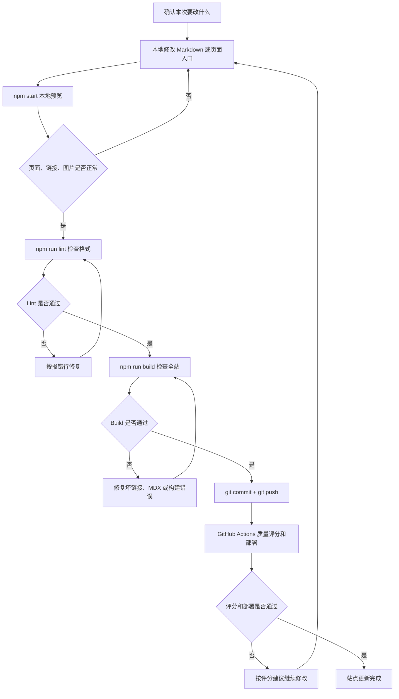
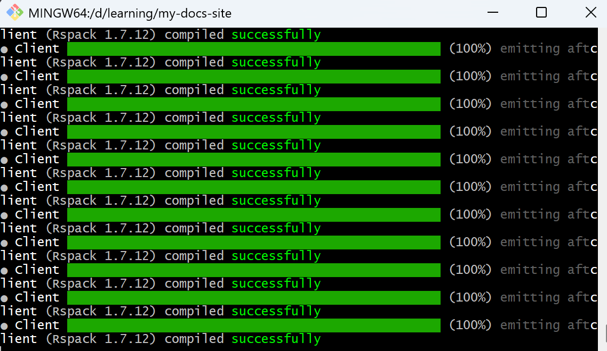
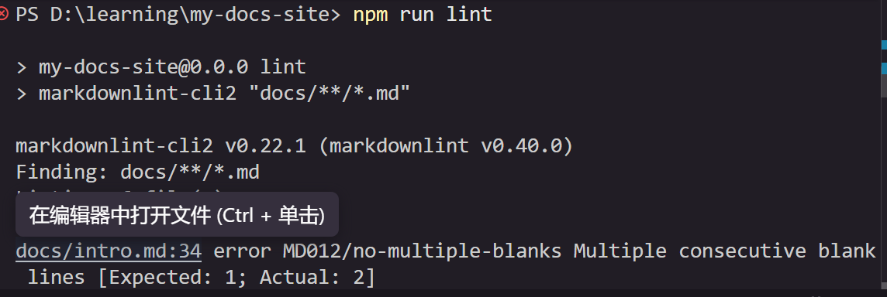

我通常先在本地修改和预览文档，检查格式并构建全站，再提交到 GitHub，由 GitHub Actions 完成质量评分和部署。这篇记录了各阶段的操作和检查方法。

{/* truncate */}

## 哪些更新会用到这个流程

平时我主要改三类内容。修改文档作品时，会检查步骤、截图说明、排障内容和预期结果；更新建站手记时，会检查标题、标签、摘要和文章链接；调整侧边栏、首页卡片或导览页时，则要确认新入口能打开、旧链接已经清理。

如果只是改错别字，我通常修改后预览，再提交。新增页面或调整导航时，会完整运行一次本地构建，检查有没有遗漏的引用。

## 整体流程



## 先找出哪些地方需要一起修改

我通常先用 `rg` 搜索旧标题或旧路径，看看哪些页面引用了它。新增或删除 `docs/` 页面时，需要检查 `sidebars.ts`、`docs/intro.md` 和首页卡片；新增或删除博客时，还要检查导览页和相关文章里的链接。

如果只是改正文，就检查段落、表格、链接和截图说明。移动图片后要核对相对路径；修改标题或 slug 后，要搜索并处理旧引用。这样可以减少改完一处、漏掉其他入口的情况。

## 第 1 步 - 本地写文档

我在编辑器中打开项目，修改 `docs/` 或 `blog/` 下的 Markdown 文件。操作指南通常需要补前提条件、预期结果和常见问题；概念文档则需要解释术语，并说明不同角色下一步该读什么。

建站手记主要调整标题、语气和段落安排。遇到对读者帮助不大的页面，也会考虑删除，同时清理导航中的入口。

新增博客时，文件开头的页面元数据（front matter）至少要包含 `slug`、`title`、`authors` 和 `tags`。如果文章较长，正文前面保留 `{/* truncate */}`，避免博客列表页预览太长。

## 第 2 步 - 本地预览页面

修改后运行：

```bash
npm start
```

浏览器会打开 `localhost:3000`，保存文件后页面会自动刷新。



我会先打开修改后的页面和站点导览页，点击首页卡片和正文中的链接，确认能进入对应内容。图片不显示时，就核对文件名、所在目录和 Markdown 中的路径。

接着检查表格有没有过宽、重复或空白的列，Mermaid 流程图是否正常显示，图中的文字是否清楚。本地预览适合边写边看；修改页面结构后，还要运行后面的全站构建，检查坏链接、MDX 语法和页面生成问题。

## 第 3 步 - 检查 Markdown 格式

提交前运行：

```bash
npm run lint
```

这个命令会检查 `docs/` 下的 Markdown 格式。常见问题包括标题前后缺空行、列表前后缺空行、代码块没有语言类型等。

如果看到类似下面的报错，就按文件名和行号去改：

```text
docs/iot-overview.md:15 MD022/blanks-around-headings Headings should be surrounded by blank lines
docs/api-docs.md:42 MD032/blanks-around-lists Lists should be surrounded by blank lines
```

大部分格式问题可以先尝试自动修复：

```bash
npm run lint:fix
```



## 第 4 步 - 构建全站

格式检查通过后，再运行：

```bash
npm run build
```

构建主要帮我确认这些问题：

| 报错类型 | 常见原因 | 处理方式 |
| --- | --- | --- |
| Broken link | 页面被删除、slug 改了、内部链接没同步 | 搜索旧路径，改成新路径或删除入口 |
| MDX compilation failed | Markdown 中写了不兼容的 JSX、注释或特殊字符 | 按报错行修正文档语法 |
| Image not found | 图片移动后路径没改，或文件名大小写不一致 | 检查图片实际位置和 Markdown 引用 |
| Sidebar item not found | `sidebars.ts` 引用了不存在的文档 | 删除旧 sidebar 项或补回文档 |

这是我提交前的最后一项本地检查。构建通过后，说明站点可以完整生成；内容是否准确、页面是否方便阅读，仍要结合前面的预览检查。

## 第 5 步 - 提交并推送

本地检查通过后，再提交代码：

```bash
git status
git add .
git commit -m "docs: 更新文档内容"
git push
```

提交前会再看一眼 `git status`，确认没有把无关文件一起提交进去。尤其是移动文档或图片时，要确认旧文件已经删除，新文件也已经加入版本控制。

## 第 6 步 - 看 GitHub Actions 结果

推送后，我会打开 GitHub Actions，查看质量评分和构建部署的结果。质量评分调用 DeepSeek API，给出分数和修改建议；构建部署负责生成 Docusaurus 网站并发布到 GitHub Pages。

如果评分没通过，就查看具体建议；如果构建部署失败，则根据日志检查坏链接、图片路径或 MDX 语法。

下面的截图展示了一次 GitHub Actions 结果摘要（build summary）。每篇文档都显示了评分，未达标的标为红叉，展开后能看到扣分依据和修改建议。


如果质量评分低于阈值，我会先看“核心问题与修改建议”，按下面的优先级处理。

1. 先改 P0 问题，例如目标不清楚、缺少下一步指引或异常处理。
2. 再改 P1 问题，例如配置说明不够，或没有说明如何验证操作结果。
3. 最后改 P2 问题，例如标题语气、链接文本和中英文空格。

这次站点里几篇文档就是按这个方式改的：先补导览页的阅读路径，再补概念文档的角色判断，最后补操作指南里的排障和验证结果。

## 常见更新场景

### 删除或移动文章

删除文档后，我会从 `sidebars.ts` 中删除对应的文档 ID，再从 `docs/intro.md` 中移除入口和阅读路径。然后搜索首页、博客和其他文档中的旧链接，运行 `npm run build` 检查是否还有坏链接。

把文章从 `docs/` 移到 `blog/` 时，需要给博客补齐 `slug`、`title`、`authors` 和 `tags`。图片也要一起移动，或者调整相对路径。原来的 `/docs/...` 链接改成 `/blog/...`；如果标题变了，还要同步修改导览页和首页卡片。

### 根据 AI 评分建议修改文档

评分建议通常会指出“缺什么”和“影响是什么”。我会把它拆成可执行动作：

| 评分问题 | 修改方式 |
| --- | --- |
| 缺少阅读路径 | 增加推荐阅读顺序、目标读者和下一步链接 |
| 读者不知道如何选择 | 增加判断清单、不同角色的阅读建议或选型说明 |
| 缺少异常处理 | 在关键步骤后补“常见问题”和“预期结果” |
| 描述太主观 | 改成更客观的“主要内容”“适合读者”“验收标准” |
